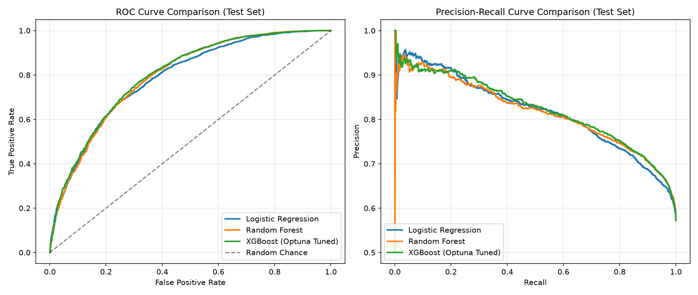
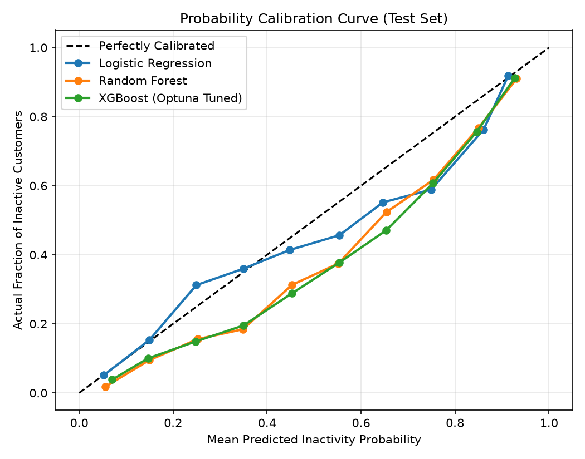
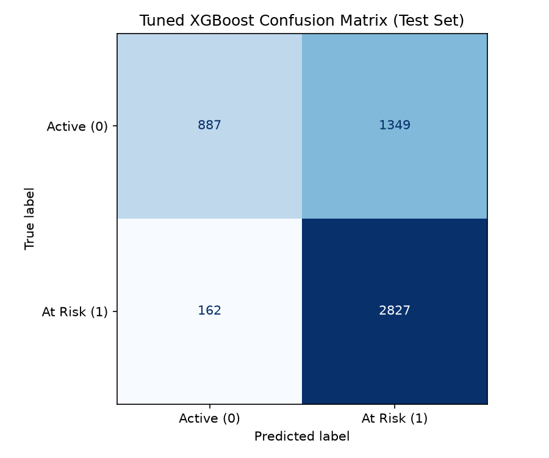
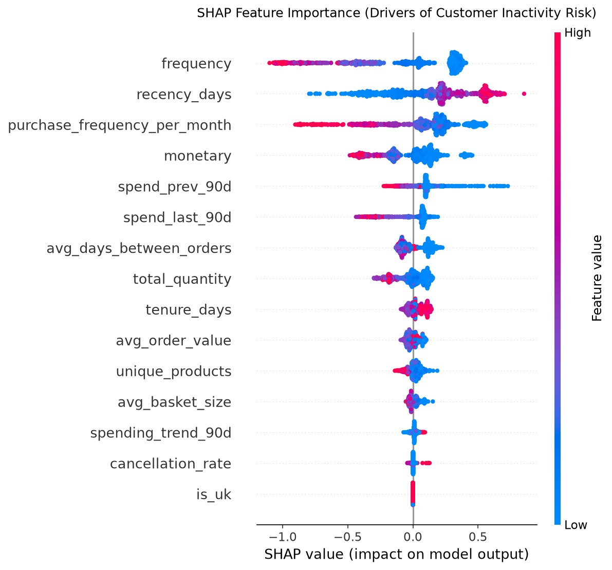
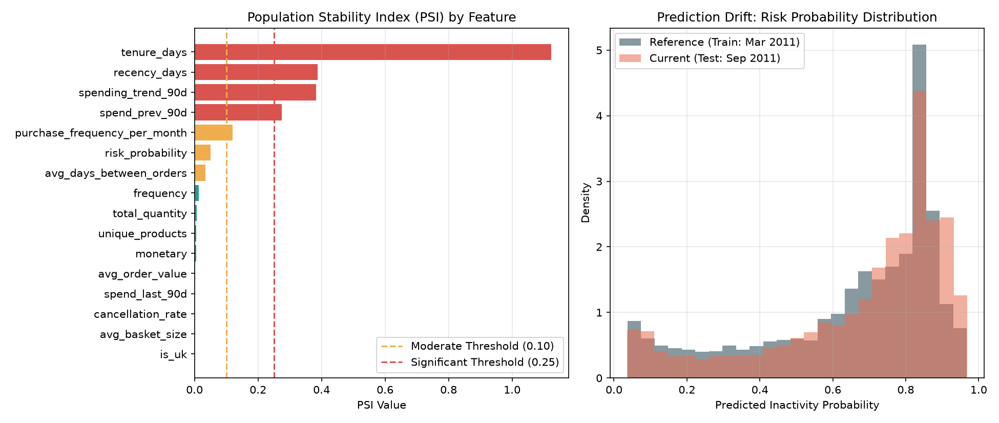

# Customer Lifecycle & Revenue Risk Engine


An end-to-end **Machine Learning Engineering & MLOps system** that predicts **customer inactivity risk**, quantifies **Expected 90-Day Revenue at Risk**, and assigns **actionable retention segments** on 1.07M+ retail transactions.

---

## 1. Business Problem & Why It Matters

Standard churn tutorials stop at binary classification (`1 = Churned`, `0 = Active`). In production e-commerce, a raw churn probability is insufficient for decision-making:
- A customer with a **92% risk score** who spends **£20/year** does not justify expensive retention outreach.
- A customer with a **65% risk score** who spends **£1,500/quarter** represents urgent revenue loss.

This engine solves the real business problem by combining **calibrated inactivity probability** with **customer monetary velocity**:

$$\text{Expected Revenue at Risk} = P(\text{Inactivity in Next 90 Days}) \times \text{Spend}_{\text{Last 90 Days}}$$

### Real-Time API Output (`/predict`)
```json
{
  "risk_probability": 0.1766,
  "risk_band": "low",
  "expected_revenue_at_risk": 114.76,
  "customer_segment": "Healthy",
  "recommended_action": "Standard lifecycle marketing + cross-sell recommendations",
  "model_version": "2"
}
```

### Actionable Customer Segmentation Matrix

| Risk Condition | 90-Day Spend | Segment | Recommended Business Action |
| :--- | :--- | :--- | :--- |
| `risk_prob >= 0.50` | `>= £500` | **High-value at risk** | Immediate personal outreach + VIP retention offer |
| `risk_prob >= 0.50` | `£0.01 – £499.99` | **At risk** | Trigger automated win-back email + time-limited discount |
| `risk_prob >= 0.50` | `£0.00` | **Low-value inactive** | Low-cost automated re-engagement newsletter only |
| `risk_prob < 0.50` | Any | **Healthy** | Standard lifecycle marketing + cross-sell recommendations |

---

## 2. System Architecture

```text
  ┌──────────────────────────┐
  │ UCI Online Retail II     │  1,067,371 raw transactions (Dec 2009 – Dec 2011)
  └────────────┬─────────────┘
               ▼
  ┌──────────────────────────┐
  │ PostgreSQL + Pandera     │  Ingests raw data -> Validates schema & filters bad-debt/guest
  │ Data Validation Gate     │  anomalies -> Stores 794,433 verified rows in clean_transactions
  └────────────┬─────────────┘
               ▼
  ┌──────────────────────────┐
  │ Point-in-Time Feature    │  Strict temporal cutoffs (Train / Val / Test) to prevent
  │ Engineering (15 Features)│  data leakage -> RFM, order velocity, cancellation rate
  └────────────┬─────────────┘
               ▼
  ┌──────────────────────────┐
  │ Model Comparison, Optuna │  Compares LogReg, Random Forest & Optuna-tuned XGBoost ->
  │ + SHAP + MLflow Registry │  Logs ROC/PR, Calibration & SHAP -> Exports production artifact
  └────────────┬─────────────┘
               ▼
  ┌──────────────────────────┐
  │ FastAPI + Docker + CI    │  Self-contained container loads exported model from /app/model_export
  │ + PSI/KS Drift Monitor   │  (Zero runtime MLflow dependency) -> Pytest + Drift Reports
  └──────────────────────────┘
```

---

## 3. Preventing Temporal Data Leakage

Instead of a random `train_test_split` (which leaks future customer behavior into historical features), the feature pipeline constructs strict **point-in-time customer snapshots**:

- **Observation Window ($X$):** Only transactions strictly *before* the cutoff date (`invoice_date < cutoff_date`) are used to compute the 15 RFM and behavioral velocity features.
- **Prediction Window ($y$):** Only transactions in the **90 days following** the cutoff date (`[cutoff_date, cutoff_date + 90 days)`) determine whether the customer went inactive (`is_at_risk = 1` if 90-day spend is £0).

| Split | Cutoff Date | Customers | At-Risk Rate | Target Window (90 Days) |
| :--- | :--- | :---: | :---: | :--- |
| **Train** | `2011-03-01` | 4,513 | 64.9% | Mar 01, 2011 – May 30, 2011 |
| **Validation** | `2011-06-01` | 4,909 | 62.6% | Jun 01, 2011 – Aug 30, 2011 |
| **Test** | `2011-09-01` | 5,225 | 55.8% | Sep 01, 2011 – Nov 30, 2011 |

---

## 4. Model Progression & Performance (Test Split)

Models were benchmarked across discrimination (`ROC-AUC`, `PR-AUC`), probability calibration (`Brier Score`), and business impact (`Top-10% Risk Precision` and `Expected Revenue at Risk`):

| Model | ROC-AUC | PR-AUC | Brier Score (Lower = Better) | Top-10% Risk Precision | Test Portfolio Revenue at Risk |
| :--- | :---: | :---: | :---: | :---: | :---: |
| **XGBoost Baseline (v1)** | 0.7744 | 0.7946 | — | — | £445,723.11 |
| **XGBoost Optuna Tuned (v2 - Production)** | **0.7996** | **0.8227** | **0.1656** | **0.9197** | **£350,829.22** |

---

## 5. Diagnostic Curves & SHAP Explainability

### ROC & Precision-Recall Comparison (`Logistic Regression` vs `Random Forest` vs `Tuned XGBoost`)


### Probability Calibration & Confusion Matrix
| Calibration Curve (Reliability Diagram) | Tuned XGBoost Confusion Matrix |
| :---: | :---: |
|  |  |

### SHAP Feature Importance (Drivers of Inactivity Risk)


---

## 6. Data & Prediction Drift Monitoring (PSI + KS-Test)

The monitoring module (`src/monitoring/drift_report.py`) evaluates **Data Drift** across all 15 input features and **Prediction Drift** on `risk_probability` between the Reference (`Train`) and Current (`Test`) snapshots using the **Two-Sample Kolmogorov-Smirnov (KS) Test** and **Population Stability Index (PSI)**:

- **$\text{PSI} < 0.10$:** `STABLE` (Core behavioral features like `avg_order_value`, `spend_last_90d`, `cancellation_rate`, and `avg_basket_size` remain highly stable with $\text{PSI} < 0.002$).
- **$0.10 \le \text{PSI} < 0.25$:** `MODERATE DRIFT` (`purchase_frequency_per_month` at $\text{PSI} = 0.1204$).
- **$\text{PSI} \ge 0.25$:** `SIGNIFICANT DRIFT` (Cumulative calendar features such as `tenure_days` and seasonal window `spend_prev_90d` shift as the customer base matures across quarters).



---

## 7. Repository Structure

```text
customer-risk-engine/
├── .github/workflows/main.yml       # CI pipeline: runs 8 Pytest tests + Docker build & smoke test
├── docker/
│   └── Dockerfile                   # Production Python 3.13-slim image baking in src/ and model_export/
├── model_export/                    # Exported production XGBoost artifact for zero-dependency serving
├── reports/
│   ├── figures/                     # Generated ROC/PR, Calibration, Confusion Matrix, SHAP & Drift plots
│   ├── drift_report.html            # Standalone interactive HTML Data & Prediction Drift dashboard
│   └── drift_metrics.json           # Machine-readable PSI and KS-Test monitoring output
├── src/
│   ├── config.py                    # SQLAlchemy PostgreSQL engine configuration
│   ├── ingestion/
│   │   └── load_to_postgres.py      # Loads raw Excel sheets into PostgreSQL (raw_transactions)
│   ├── validation/
│   │   ├── schemas.py               # Pandera schemas for raw and cleaned transaction tables
│   │   ├── run_validation.py        # Audits raw data quality and surfaces schema violations
│   │   └── clean_data.py            # Cleans records, flags cancellations & writes clean_transactions
│   ├── features/
│   │   ├── queries.py               # Extracts validated transactions from PostgreSQL
│   │   └── build_features.py        # Point-in-time RFM + velocity feature engineering (Parquet + DB)
│   ├── models/
│   │   ├── evaluate.py              # ML metrics, Brier score, top-decile precision & Revenue at Risk
│   │   ├── xgbbaseline_train.py     # Baseline XGBoost training run logged to MLflow
│   │   ├── train.py                 # Optuna hyperparameter tuning + MLflow registration
│   │   ├── compare_and_explain.py   # Benchmarks LogReg/RF/XGBoost + generates SHAP & diagnostic plots
│   │   └── predict.py               # Batch scoring pipeline writing to customer_risk_scores table
│   ├── monitoring/
│   │   └── drift_report.py          # Computes PSI & KS-Test Data/Prediction Drift (HTML/JSON/PNG)
│   └── api/
│       ├── schemas.py               # Pydantic v2 request/response contracts
│       └── main.py                  # FastAPI service (/ and /predict) loading from model_export/
├── tests/
│   ├── sample_request.json          # Sample customer feature payload for API testing
│   ├── test_validation.py           # Unit tests for Pandera data quality schemas
│   ├── test_features.py             # Unit tests verifying zero temporal leakage in feature logic
│   ├── test_monitoring.py           # Unit tests for PSI drift calculation math
│   └── test_api.py                  # FastAPI TestClient integration tests against model_export/
├── docker-compose.yml               # Local container orchestration
├── requirements.txt                 # Pinned production dependencies for Docker API container
├── requirements-dev.txt             # Full test & pipeline dependencies for local dev and CI
└── README.md
```

---

## 8. Quickstart Guide

### A. Run the Containerized API (No Local DB or MLflow Required)
```bash
docker-compose up --build
```
- **Interactive Swagger UI:** `http://localhost:8000/docs`
- **Health Check:** `GET http://localhost:8000/`

### B. Run the Automated Test Suite (8 Unit & Integration Tests)
```bash
pip install -r requirements-dev.txt
pytest -v
```

### C. Run the Offline Training, Explainability & Drift Pipeline
```bash
# 1. Ingest raw Excel sheets to PostgreSQL
python -m src.ingestion.load_to_postgres

# 2. Validate and clean transactions with Pandera
python -m src.validation.clean_data

# 3. Build leak-free temporal feature snapshots (Train/Val/Test)
python -m src.features.build_features

# 4. Tune XGBoost with Optuna and log to MLflow
python -m src.models.train

# 5. Benchmark LogReg/RF/XGBoost & generate SHAP + calibration plots
python -m src.models.compare_and_explain

# 6. Run batch scoring across all active customers
python -m src.models.predict

# 7. Generate Data & Prediction Drift monitoring report (HTML, PNG, JSON)
python -m src.monitoring.drift_report
```